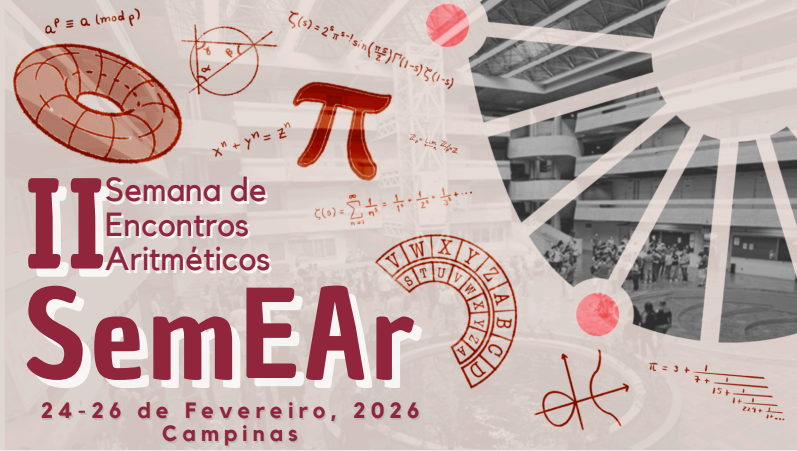

---
#
# By default, content added below the "---" mark will appear in the home page
# between the top bar and the list of recent posts.
# To change the home page layout, edit the _layouts/home.html file.
# See: https://jekyllrb.com/docs/themes/#overriding-theme-defaults
#
layout: home
---

Associate professor at <a href="https://www.ime.unicamp.br/en" target="_blank">IMECC–Unicamp</a>, member of IMECC's <a href="https://geotop.ime.unicamp.br/" target="_blank">Geometry and Topology (GeoTop)</a> research group, and of the <a href="https://www.cbg.ime.unicamp.br/en/cbg-homepage-english/" target="_blank">Brazilian Center for Geometry (CBG)</a>.

I work in the areas of Number Theory and Algebraic Geometry, mainly on questions involving periods of algebraic varieties and their differential equations, modular forms, transcendence, and algebraicity.

I did my PhD at the <a href="https://www.imo.universite-paris-saclay.fr/fr/" target="_blank">LMO - Université Paris-Saclay</a>, under the supervision of <a href="https://www.imo.universite-paris-saclay.fr/~jean-benoit.bost/Accueil.html" target="_blank">Jean-Benoît Bost</a>, and I was a postdoc at the <a href="https://www.mpim-bonn.mpg.de/" target="_blank">MPIM - Bonn</a> and at the <a href="https://www.maths.ox.ac.uk/" target="_blank">MI - University of Oxford</a>, working with <a href="https://www.maths.ox.ac.uk/people/francis.brown" target="_blank">Francis Brown</a>.



<!--
<h4>News</h4>

<ul>
  <li>Hilary Term 2027: Visiting Scholar at Corpus Christi College, Oxford.</li>
  <li>February 2027: second CBG workshop at IMECC–Unicamp.</li>
</ul>
-->

<!--
<h4>
	II SemEAr
</h4>

The second <i>Semana de Encontros Aritméticos</i> will take place in Campinas-SP from 24 to 27 February 2026. <a href="https://sites.google.com/ufg.br/iisemear/" target="_blank">More information.</a>

-->

<h4>
	Contact information
</h4>

	tfonseca at unicamp.br

 

IMECC - Unicamp  
Departamento de matemática  
Rua Sérgio Buarque de Holanda, 651, Cidade Universitária  
13083-859 Campinas-SP, Brazil  

Last update: 23 October 2026

